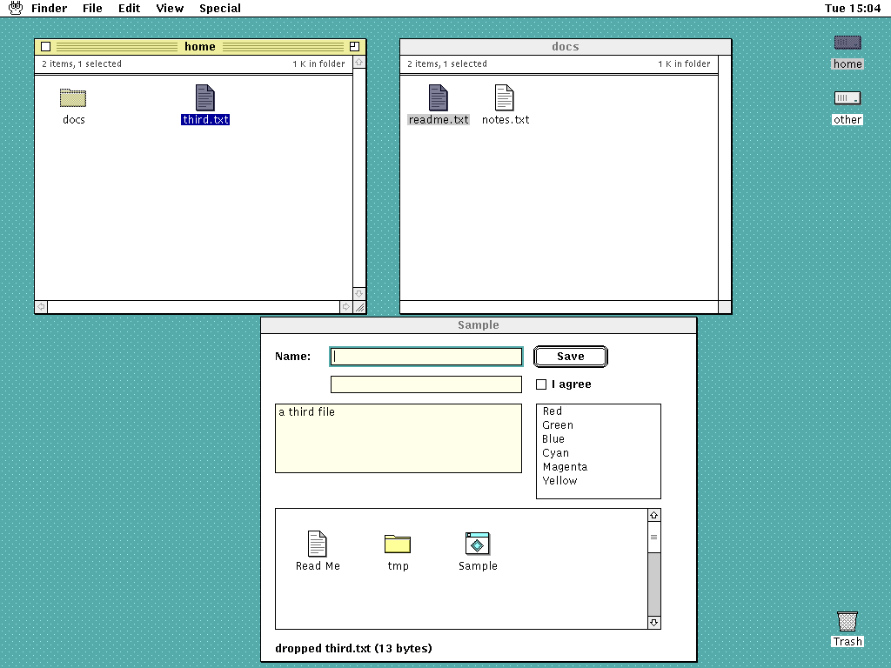

# 9/UX

A Macintosh-inspired graphical environment for 9front.



<sub>A real frame from the end-to-end drag-and-drop test
([`test/e2e/drag_test.zig`](test/e2e/drag_test.zig)), running headless on h9:
the rio fork in 9/UX mode, Desktop, and the libux sample app.</sub>

9/UX brings the classic Mac and A/UX desktop experience (a spatial desktop,
a global menu bar, consistent controls and dialogs, icons, and
resource-driven presentation) to 9front, built the Plan 9 way: rio and
libdraw draw the screen, 9P exposes every application's UI state and
commands as files, namespaces define the working environment, the plumber
opens documents, and ndb holds human-editable metadata.

It is **not** an emulator, a Macintosh ABI, or an A/UX reimplementation.
Native 9front programs stay first-class, and existing rio programs keep
working unchanged.

> **Design principle:** keep the Macintosh's direct-manipulation desktop,
> but make every meaningful object, action, and resource visible as a
> Plan 9 file.

## Status: v0.1

All eight [v0.1 acceptance criteria](docs/design.md#acceptance-criteria-for-v01)
pass headless on h9; [docs/release.md](docs/release.md) has each result,
the end-to-end demo, and the open issues. What works today:

- **rio fork** (`rio -u` for 9/UX mode): a desktop layer, a global menu
  bar that follows the focused app, title-bar chrome, and a drag broker,
  all under `/dev/ux`. With 9/UX mode off it's stock rio, and acme, sam,
  rc windows and nested rio keep working beside 9/UX apps.
- **Desktop**: volume icons on the desktop, spatial folder windows,
  open, rename, duplicate, Get Info, Trash, remembered layout, and
  double-click to open documents through the plumber. A remote 9P server
  works as a volume, and reports honestly what it can't do.
- **libux Toolbox**: windows, menus, dialogs and alerts, and controls
  (button, checkbox, text field, list, icon view), each app serving its
  control tree over 9P, so `echo activate >.../ctl` presses a button.
- **uxd** aggregates every app's tree at `/mnt/ux` with per-app policy;
  **uxmeta** keeps associations, volumes and Desktop layout in ndb files
  that survive restarts and external edits; **resfs** serves classic
  `ICN#`, `icl8`, menu, dialog and string resources at `/mnt/res`;
  **clipd** is a typed clipboard kept in step with rio's snarf.
- **Drag and drop** between Desktop windows, onto volumes, and into an
  app's text field, brokered by rio.

Still to do by hand before tagging: CPU-server (`rcpu`, drawterm)
sessions and 16- and 8-bit screens on real hardware. Classic `ICN#`
and `icl8` icons already match pixel for pixel on 9front's own kernel
and framebuffer in QEMU.

## Components

| Directory | Component | Owns | Interface |
|---|---|---|---|
| [`rio/`](rio/) | Extended rio | Windows, desktop layer, global menu bar, input routing, drag brokering | Stock rio 9P files, plus `/dev/ux` ([devux.md](docs/protocols/devux.md)) |
| [`libux/`](libux/) | Toolbox | Controls, layout, dialogs, menus, event model | C library; each app serves its control tree over 9P ([ux.md](docs/protocols/ux.md)) |
| [`uxd/`](uxd/) | UI registry and broker | App registration, UI-tree aggregation, policy, event routing | `/mnt/ux` |
| [`uxmeta/`](uxmeta/) | Metadata service | Associations, volumes, preferences, Desktop layout | `/mnt/meta` over ndb files ([meta.md](docs/protocols/meta.md)) |
| [`resfs/`](resfs/) | Resource file server | Decoding classic `.rsrc` icons, menus, dialogs, strings | Read-only `/mnt/res` ([res.md](docs/protocols/res.md)) |
| [`clipd/`](clipd/) | Typed clipboard | Several representations of one copy, synced with snarf | `/mnt/clip` ([clip.md](docs/protocols/clip.md)) |
| [`desktop/`](desktop/) | Desktop | Spatial desktop, folder windows, file operations, launching via plumber | A libux app with its own UI tree |
| [`apps/sample/`](apps/sample/) | Sample app | A libux app showing every control, and a drop target | A libux app |

`rio/` is stock 9front rio at release 11952 (see [`rio/UPSTREAM`](rio/UPSTREAM)),
with 9/UX's changes on top as separate commits so the fork's diff is
always visible. Every interface between components is a file protocol in
[docs/protocols](docs/protocols/), each with a fake under
[`test/fakes/`](test/fakes/).


## Building and running

Development runs on [h9](https://github.com/progrium/hyper9), which runs
9front's own binaries (compilers, `mk`, rio) directly from the host
shell, without booting a VM. `scripts/h9.sh` runs h9 at the commit pinned
in [`scripts/pins.sh`](scripts/pins.sh); the first run clones and builds
it and its 9front root under `.local/`. Below, `h9` means `scripts/h9.sh`
(or your own build, with `H9=/path/to/h9`).

```sh
h9 --rc 'mk'                          # build every component with 9front's mk
h9 --gfx rio/7.out -u                 # run the fork in 9/UX mode in a host window (6.out on amd64)
h9 --gfx rio/7.out -i 'window acme'   # with a legacy app beside it
```

On Linux, `h9 --gfx` needs h9 built with X11 (`H9_BUILD_FLAGS=-Dgfx=x11`
before the first run); the tests don't. Setup, the everyday loop, and
what still needs a real 9front VM are in
[docs/development.md](docs/development.md) and [docs/vm.md](docs/vm.md).

## Testing

```sh
scripts/test.sh                        # everything: build, host, unit, system, gui
scripts/test.sh unit                   # one layer
scripts/test.sh gui -- -Dfilter=e2e    # just the end-to-end demo and drag tests
```

The layers, cheapest first: `build` (mk everywhere), `host` (parsers
built for the host with sanitizers), `unit` (C and rc interface tests
inside h9), `system` (tests that drive several h9 machines, such as a
remote volume served with `h9 --serve`), and `gui` (a Zig harness that
embeds h9 with a headless screen, injects mouse and keyboard input,
compares pixels with golden images, and drives the 9P files at the same
time). GUI tests save screenshots to `.local/test/artifacts/`. How to
write each kind is in [docs/testing.md](docs/testing.md).

## Layout

```text
docs/
    design.md          the 9/UX design, with the v0.1 acceptance criteria
    plan.md            phased development plan
    workplan.md        the plan split into parallel workstreams
    release.md         v0.1 acceptance results, the end-to-end demo, open issues
    development.md     environment, build, and run with h9
    testing.md         the test layers and how to write each kind
    vm.md              the 9front VM, for checks h9 can't stand in for
    h9-needs.md        gaps found in h9, with workarounds here
    protocols/         every 9P interface between components
    images/            screenshots
rio/                   rio fork (stock 9front rio 11952, plus 9/UX commits)
libux/                 Toolbox library
uxd/                   UI registry and event broker
uxmeta/                ndb-backed metadata service
resfs/                 resource-fork file server
clipd/                 typed clipboard
desktop/                Desktop
apps/sample/           libux sample app
assets/                style guide, mockups, icons, cursors, patterns
test/                  harness, fakes, rio regression, GUI and e2e tests
scripts/               pinned versions, h9.sh, test.sh, vm.sh, zig.sh
mkfile                 builds every component that has a mkfile
```

9/UX is MIT licensed (see [LICENSE](LICENSE)); `rio/` keeps 9front's MIT
license and notice.
