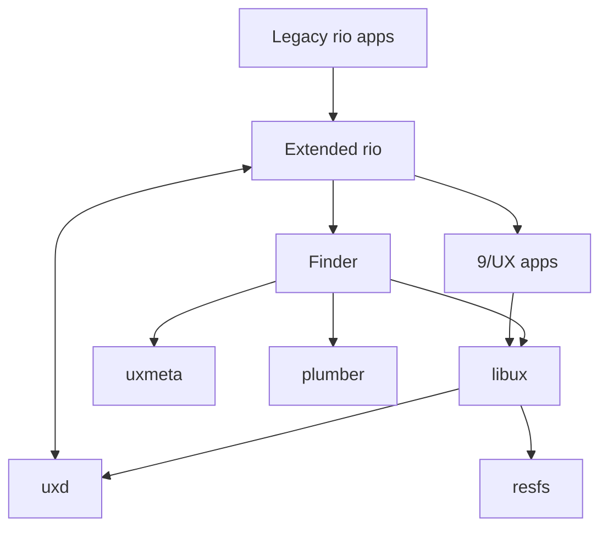

# 9/UX

A Macintosh-inspired graphical environment for 9front.

9/UX brings the classic Mac and A/UX desktop experience (a spatial Finder,
a global menu bar, consistent controls and dialogs, icons, and
resource-driven presentation) to 9front, built the Plan 9 way: rio and
libdraw draw the screen, 9P exposes every application's UI state and
commands as files, namespaces define the working environment, the plumber
opens documents, and ndb holds human-editable metadata.

It is **not** an emulator, a Macintosh ABI, or an A/UX reimplementation.
Native 9front programs stay first-class, and existing rio programs keep
working unchanged.

> **Design principle:** keep the Macintosh's direct-manipulation desktop,
> but make every meaningful object, action, and resource visible as a
> Plan 9 file.

**Status:** design stage. Nothing here runs yet beyond stock rio. See the
[design](docs/design.md) and the [development plan](docs/plan.md).

## Components

| Directory | Component | Owns | Interface |
|---|---|---|---|
| [`rio/`](rio/) | Extended rio | Windows, desktop layer, global menu bar, input routing, drag brokering | Stock rio 9P files, plus additive `/dev/ux/...` |
| [`libux/`](libux/) | Toolbox | Controls, layout, dialogs, menus, event model | C library; each app serves its control tree over 9P |
| [`uxd/`](uxd/) | UI registry and broker | App registration, UI-tree aggregation, policy, event routing | `/mnt/ux/apps/...` |
| [`uxmeta/`](uxmeta/) | Metadata service | Associations, volumes, preferences, Finder layout | 9P queries and updates over ndb files |
| [`resfs/`](resfs/) | Resource file server | Decoding classic `.rsrc` icons, menus, dialogs, strings | Read-only `/mnt/res/...` |
| [`finder/`](finder/) | Finder | Spatial desktop, folder windows, file operations, launching via plumber | A libux app with its own UI tree |

`rio/` starts as stock 9front rio at release 11952, vendored unchanged
(see [`rio/UPSTREAM`](rio/UPSTREAM)); 9/UX changes land on top as
separate commits so the fork's diff is always visible.



## Developing

Day-to-day development runs on [h9](https://github.com/progrium/hyper9),
which runs 9front's own binaries (compilers, `mk`, rio) directly from the
host shell, without booting a VM. Edit in your host editor, build with
9front's `mk`, and run the result in a host window:

```sh
h9 --rc 'cd rio && mk'          # 9front's compiler and mk build the fork
h9 --gfx rio/7.out              # run it in a host window (arm64 Mac)
```

The same machines run headless for automated tests: a small Zig harness
embeds h9, starts the rio fork on an in-memory screen, injects mouse and
keyboard input, reads pixels, and drives the 9P files. A real 9front VM is
kept for the checks h9 can't stand in for. Details are in
[docs/development.md](docs/development.md).

## Layout

```text
docs/
    design.md          the 9/UX design (v0.1 draft)
    plan.md            phased development plan
    development.md     environment, build, and test setup with h9
rio/                   rio fork (stock 9front rio at 11952 to start)
libux/                 Toolbox library
uxd/                   UI registry and event broker
uxmeta/                ndb-backed metadata service
resfs/                 resource-fork file server
finder/                Finder
mkfile                 builds every component that has a mkfile
```
