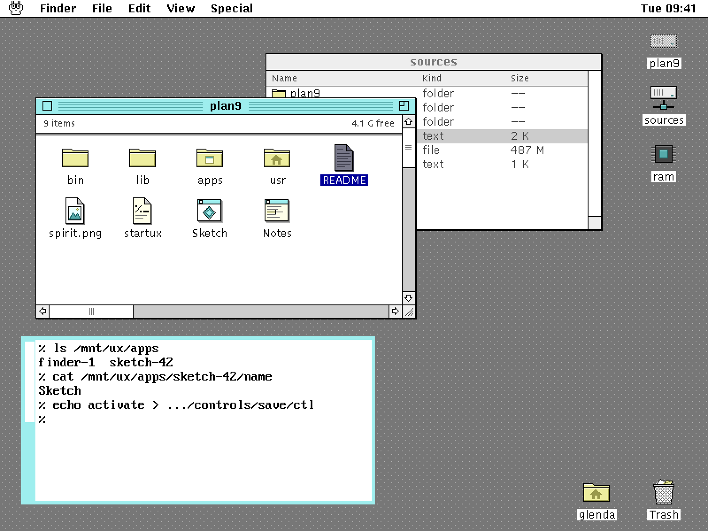
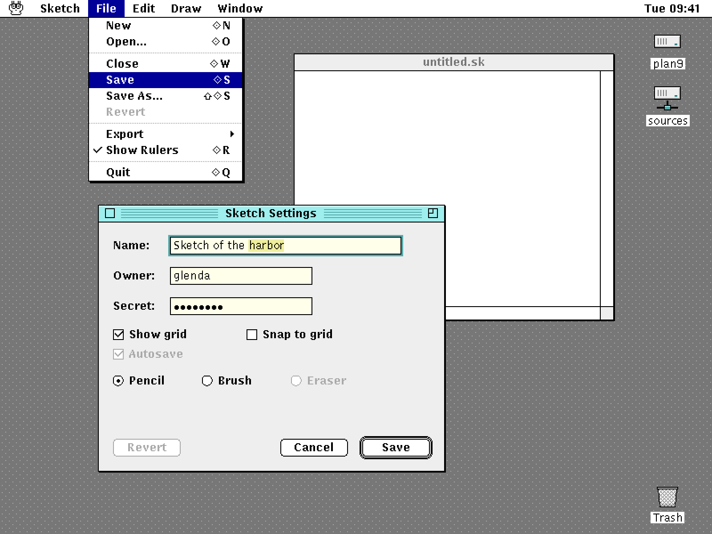
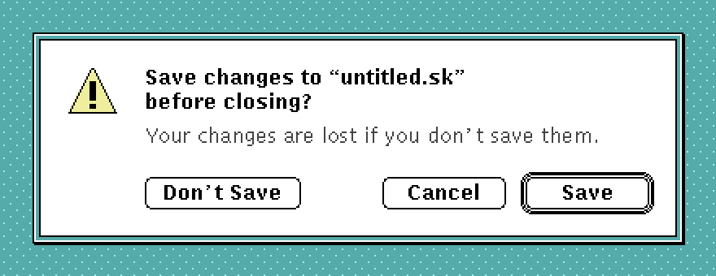
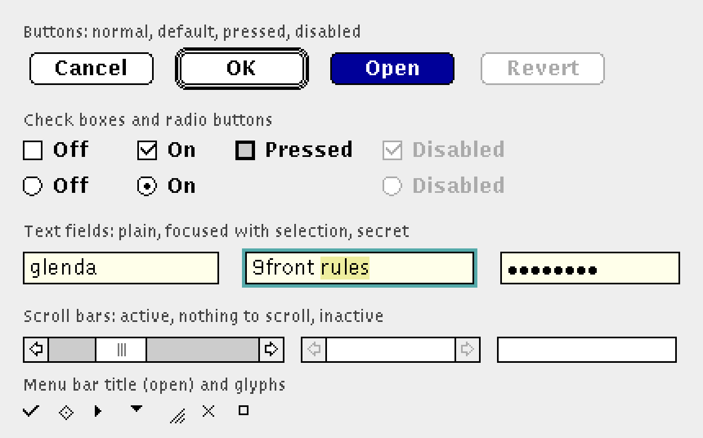
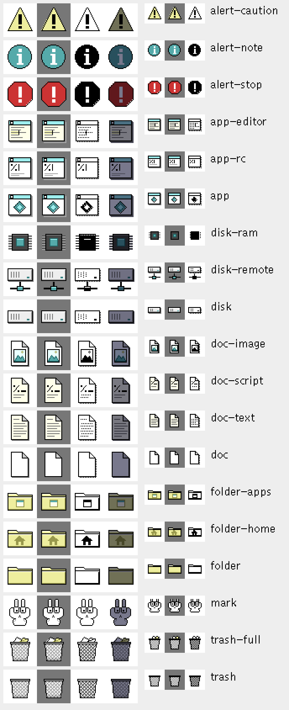
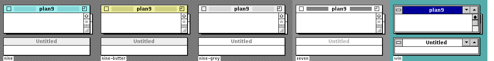
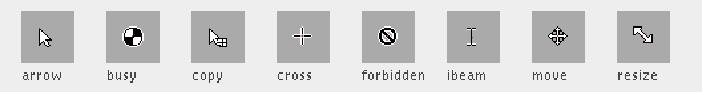
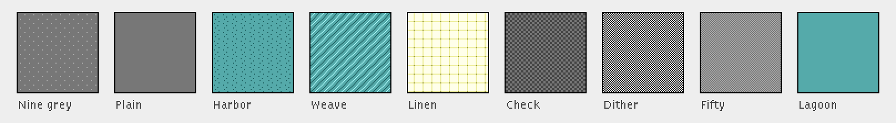

# 9/UX visual design

The look of 9/UX: palette, fonts, metrics, window chrome, the menu bar,
controls, icons, cursors and desktop patterns. rio (S2), libux (S3) and
Finder (S7b) draw toward the mockups here, and everything they draw
comes from the sources in this directory.

Every graphic here is original to 9/UX. None is derived from Apple
artwork, and 9/UX ships no Apple resources; people can import their own
`.rsrc` files through resfs. The fonts are ones 9front already ships.



## Principles

1. **Macintosh structure, Plan 9 colour.** The shapes follow the classic
   desktop (a global menu bar, framed windows with a title bar, a close
   and a zoom box, push buttons, icons with labels). The colours are rio's
   and acme's own (cream text, butter selection, the sea and teal of rio's
   window borders), so 9/UX windows and legacy rio windows sit together on
   one screen without either looking foreign.
2. **Black outlines, light fills.** Everything reads in 1 bit. Each colour
   has a defined 1-bit rendering, so the same source gives the colour icon
   and the `ICN#`-style one.
3. **Sixteen colours.** Chrome, controls, icons and patterns use only the
   palette below, so the whole look fits a 4-bit colour table.
4. **Whole pixels at 1x.** Metrics are in pixels at 1x. A larger setting
   scales by whole numbers (2x) and swaps in the large fonts; nothing is
   drawn at fractional sizes.
5. **One source of truth.** The values live in `palette.ndb`,
   `metrics.ndb`, `fonts.ndb` and `glyphs.txt`. The C header and the
   mockups are generated from them, so changing a value changes the code
   and the pictures together.

## Palette

From [`palette.ndb`](palette.ndb). In C, `UXname` from `gen/uxstyle.h`
is the value to pass to `allocimage`.

| Name | Letter | RGB | 1-bit | Use |
|---|---|---|---|---|
| ink | `K` | `000000` | black | outlines, text, frames |
| paper | `W` | `FFFFFF` | white | menus, document windows, label plates |
| cream | `Y` | `FFFFEA` | white | text field and text view background (acme's) |
| butter | `y` | `EEEE9E` | white | text selection (rio's); folder fill |
| olive | `o` | `99994C` | black | folder shading, embossed marks (rio's yellowgreen) |
| mist | `c` | `EAFFFF` | white | highlight line on active title bars (acme's tag) |
| sea | `C` | `9EEEEE` | white | active title bar, inactive rio border (rio's palegreygreen) |
| teal | `T` | `55AAAA` | black | title rules, focus ring, dialog band, accents (rio's greygreen) |
| deep | `D` | `226666` | black | dark accent in icons |
| navy | `B` | `000099` | black | selection of objects: menu items, list rows, icon labels, pressed buttons |
| red | `R` | `CC3333` | black | stop alerts, destructive emphasis |
| grey1 | `1` | `EEEEEE` | white | dialog and control-panel face, inactive title bar |
| grey2 | `2` | `CCCCCC` | white | scroll track, pressed check box |
| grey3 | `3` | `AAAAAA` | white | disabled text and outlines, separators |
| grey4 | `4` | `777777` | 50% | the desktop (rio's background), shadows, secondary marks |
| grey5 | `5` | `444444` | black | secondary text, grow box ridges |

Two selection colours, on purpose: **butter** selects *text* (as in rio
and acme), **navy** selects *objects* (menu items, list rows, icons).

## Fonts

From [`fonts.ndb`](fonts.ndb). All ship with 9front under
`/lib/font/bit`, so 9/UX bundles no fonts.

| Role | Default | Large setting | Used for |
|---|---|---|---|
| system | `lucidasans/boldunicode.7.font` (13 px) | `dejavusansbd/unicode.16.font` | menu bar, menus, window titles, buttons, check box and radio labels, alert text |
| body | `lucidasans/unicode.7.font` (13 px) | `dejavusans/unicode.16.font` | field text, lists, icon labels, explanatory text |
| small | `lucidasans/unicode.6.font` (11 px) | `dejavusans/unicode.12.font` | list headers, window info bars, Get Info detail |
| mono | `vga/unicode.font` (16 px) | `terminus/unicode.18.font` | rc windows and code (rio's default) |

Lucida Sans Bold at 12 px gives the system font the weight a classic
desktop needs without copying any Apple face. A later option is an
original 9/UX bitmap system font; it would replace the `system` row and
nothing else.

## Metrics

All in [`metrics.ndb`](metrics.ndb); `gen/uxstyle.h` has them as
`UXmenubarheight` and so on. The main ones:

| | |
|---|---|
| Menu bar | 20 px tall including a 1 px ink rule at the bottom |
| Menu item | 18 px; separator 7 px; 20 px left pad for the check mark |
| Title bar | 20 px including its bottom rule; close and zoom boxes 11 px, 8 px from the frame |
| Window frame | 1 px ink, plus a 1 px ink shadow right and below |
| Scroll bar | 16 px; arrows 16x16; thumb at least 16 px; grow box 16x16 |
| Push button | 20 px tall, corner radius 4, at least 64 px wide, 14 px label padding |
| Check box, radio | 12 px, 6 px to the label |
| Text field | 20 px tall, 4 px padding, 2 px focus ring |
| List row | 16 px |
| Dialog | 16 px margins; alert icon 32 px; alert text starts at x=64 |
| Icon view | 76x60 cells; label 3 px under the icon |
| Desktop | icons in a column 12 px from the right edge, 64 px apart |

## The menu bar (rio)



- A paper strip across the top of the screen, `UXmenubarheight` tall,
  ending in a 1 px ink rule.
- At the left, the 9/UX mark (`icons/mark.icon`, a 16 px Glenda) opens
  the system menu. Menu titles start at x=36, in the system font, with 9 px either
  side.
- The first title is the foreground application's name, so the bar always
  says whose menus it shows. A legacy window with no registered menus
  gets rio's own operations under its window label.
- An open title, and the item under the pointer, are drawn in **navy**
  with paper text. Disabled items are grey3. Separators are a dotted
  grey3 line.
- Menus are paper with a 1 px ink frame and a 2 px ink drop shadow.
  A check mark (`glyphs.txt`: `check`) sits in the left padding; a
  submenu shows `submenu` at the right.
- **Shortcuts** are shown right-aligned: the modifier glyphs, then the
  `mod` glyph (a small open diamond, ◇) for the Command key, then the
  key. Command is `Kmod4` by default (Super on PC keyboards, Command on
  a Mac's), as [`devux.md`](../docs/protocols/devux.md) settles it; it
  is deliberately not Ctl, so legacy programs keep their control keys.
  Extra modifiers from the `key=` syntax draw in the order `ctl` (^),
  `alt` (the ISO alternate symbol), `shift` (the ISO outlined arrow),
  then ◇ and the key. Named keys (`del`, `f4`, ...) are written out in
  the system font.
- An item with `check=on` shows `check`; `check=mixed` shows `mixed`.
- The clock, if shown, is right-aligned in the system font, 12 px from
  the edge.

## Windows (rio draws the frame, libux the inside)


- **Frame:** 1 px ink, with a 1 px ink shadow offset right and down.
- **Active title bar:** sea, with a mist line along its top and a 1 px
  ink rule under it. The title is centred in the system font. Either side
  of it, from the close box to the zoom box, run teal rules every 3 px,
  leaving 8 px clear around the title. The close box is at the left and
  the zoom box at the right: 11 px paper squares with an ink outline; the
  zoom box has a small square in its top left. Pressing the close box
  shows `close` inside it.
- **Inactive title bar:** grey1, title in grey4, no rules and no boxes.
  Its scroll bars go blank (paper, no arrows or thumb), as in the mockup's
  `sources` window, so the active window is obvious.
- **Body:** paper for documents and Finder windows; grey1 for dialogs,
  settings and control panels.
- **Dialogs** have no title bar: a 1 px ink frame, a 2 px teal band, and
  a 1 px ink frame inside it. Alerts put their icon at the top left
  (16 px in), text at x=64, and buttons along the bottom with the
  default button on the right.



- **Legacy rio windows** keep rio's own look, unchanged (the rc window
  in the desktop mockup): the 4 px teal or sea border and the left scroll
  bar.

## Controls (libux)



- **Push button:** paper, 1 px ink outline, radius 4, label in the
  system font. **Default** button: a 2 px ink ring with a 1 px gap outside it.
  **Pressed:** navy fill, paper label. **Disabled:** grey3 outline and
  label.
- **Check box:** 12 px paper square, ink outline; on shows the `check`
  glyph, mixed shows `mixed`; pressed is grey2 with a double outline. **Radio:** a 12 px
  circle; on shows the `radio` dot.
- **Text field:** cream with a 1 px ink outline; focus adds a 2 px teal
  ring outside; selected text is on butter; the caret is a 1 px ink line.
  Secret fields draw a bullet per character, and never expose the text
  (design §9).
- **Scroll bar:** grey2 track, grey1 arrow boxes with outlined arrows,
  a paper thumb with grip lines. With nothing to scroll, the track is
  paper and the arrows grey3. In an inactive window it is blank.
- **List:** paper rows 16 px tall; a grey1 header in the small font
  with a grey3 rule; the selected row navy with paper text (grey2 when
  the window is inactive).
- **Labels** for fields use the system font; explanatory text uses the
  body font in grey5.

## Finder (icon views and the desktop)

- Icons are 32 px in icon view, 16 px in list view.
- A label sits 3 px under its icon, centred, in the body font. On the
  desktop a label sits on a paper plate (2 px padding) so it reads over
  any pattern. Labels longer than 72 px are elided in the middle.
- **Selected:** the icon darkened (each channel scaled by 120, 120, 150 out of 255) and its
  label in paper on navy. In an inactive window, the label plate is
  grey2.
- **Open:** an icon whose folder or volume window is open is hatched
  with a grey3 checkerboard (the `plan9` disk in the desktop mockup).
- Volumes stack down the right edge of the desktop from the top; the
  Trash sits at the bottom right.

## Icons



Each `icons/NAME.icon` holds a 32 px and a 16 px grid of palette letters.
The 1-bit form and the mask come from the same grid: the mask is every
non-`.` pixel, and each colour renders by its `bit` attribute.

| Icon | For |
|---|---|
| `disk`, `disk-remote`, `disk-ram` | local disk, a 9P volume mounted from another machine, a ramfs |
| `folder`, `folder-apps`, `folder-home` | folders; the applications folder; a home directory |
| `doc`, `doc-text`, `doc-image`, `doc-script` | generic file, text, image, rc script |
| `app`, `app-rc`, `app-editor` | generic application, rc window, text editor |
| `trash`, `trash-full` | the Trash: an open wire basket, empty and with paper in it |
| `alert-stop`, `alert-note`, `alert-caution` | alert icons for libux `Dialog` |
| `mark` | the 9/UX mark, a pixel Glenda: the system menu and the about box |

Drawing new icons:

- Outline in ink, 1 px. Fill with paper, cream or butter; shade with
  grey or olive; put colour (teal, navy, red) only on the one detail that
  says what the thing is.
- Light comes from the top left: a paper or mist highlight top and left,
  a grey3 line bottom and right, a 1 px grey4 shadow outside.
- Draw the 16 px size by hand; don't scale the 32.
- Check it on white, on the default desktop, in 1 bit and selected
  (`tools/mockup.py` renders `mockups/icons@2x.png` with all four).

## Theme explorations

`tools/mockup.py` can draw the same scenes in other themes, to try
directions before changing the guide. They are in
[`mockups/themes/`](mockups/themes/); every theme keeps the global menu
bar, the Finder and the palette, and changes only chrome and controls.



| Theme | What changes |
|---|---|
| `nine` | the guide as written above (sea title bar) |
| `nine-butter` | title bar in rio's butter with olive rules |
| `nine-grey` | neutral grey1 title bar with grey3 rules |
| `seven` | closer to System 7: paper title bars with dense ink rules, ink selection, rounder buttons, white dialogs with an ink band, dithered scroll tracks, a 50% grey desktop, rounded screen corners |
| `win` | closer to Windows 3.1: solid navy title bar with paper title, a control box and shrink/grow buttons, a grey sizing border, bevelled grey buttons and scroll bars, grey dialogs, a teal desktop |

The themes are defined at the top of `tools/mockup.py`; once one is
chosen, its values move into `metrics.ndb` and `palette.ndb` and this
guide.

## Cursors



`cursors/NAME.cursor`: 16x16 grids with a hotspot (the red dot above);
`gen/uxcursors.c` has them as Plan 9 `Cursor` values
(`uxarrowcursor`, ...).

| Cursor | For |
|---|---|
| `arrow` | the default (9/UX windows and the desktop) |
| `ibeam` | over editable text |
| `busy` | the app is working; libux may rotate it a quarter turn per tick |
| `cross` | precise picking |
| `move`, `copy` | dragging; `copy` when the drop will copy |
| `resize` | the grow box |
| `forbidden` | a drop target that won't accept the drag |

Legacy rio windows keep their own cursors.

## Desktop patterns



8x8 tiles in [`patterns/patterns.txt`](patterns/patterns.txt). The
first, **Nine grey**, is the default: rio's own background grey with a
faint grey3 dot, so the desktop looks like rio's but reads as a surface.

## Chrome glyphs

[`glyphs.txt`](glyphs.txt) holds the small bitmaps rio and libux draw
with: `check`, `mixed`, `mod`, `shift`, `ctl`, `alt`, `submenu`, `popup`,
the four scroll arrows, `grow`, `close`, `zoom`, `radio` and `thumbgrip`. `gen/uxglyphs.c` has them as
1-bit rows (an ink layer and a white layer) ready for `loadimage`.

## Building

The tools are host-side Python 3 with the standard library only.

```sh
python3 assets/tools/mkassets.py          # sources -> assets/gen/
python3 assets/tools/mkassets.py -check   # fail if gen/ is stale (for CI)
UXFONTS=/path/to/9front/lib/font/bit \
    python3 assets/tools/mockup.py assets/mockups
```

`mockup.py` reads 9front's fonts from `$UXFONTS`, or from
`$H9ROOT/lib/font/bit` when h9's root is built. `gen/` and `mockups/` are
committed, so nobody needs to run the tools to use the assets.

`gen/` holds:

| File | What |
|---|---|
| `icons/NAME.SIZE.img` | uncompressed `a8r8g8b8` image(6) with alpha, for `readimage` |
| `icons/NAME.SIZE.1.img` | the same icon in 1 bit (black, white, clear) |
| `patterns/NAME.img` | one 8x8 `r8g8b8` tile, to use with `replclipr` |
| `uxstyle.h` | `UXink`... colours and `UXmenubarheight`... metrics |
| `uxcursors.c` | Plan 9 `Cursor` structs |
| `uxglyphs.c` | the chrome glyphs |

The mockups are drawn by a small software renderer (`tools/mockup.py`)
that follows this guide to the pixel. When rio or libux draws something
differently, decide which is right and fix the other, and this file.

## Packaging as resources

When resfs has its resource compiler (S6, work item 5), the same sources
compile into a 9/UX system `.rsrc`: each icon as `ICN#` and `ics#` (from
the 1-bit form and mask) plus `icl4`/`ics4` and `icl8`/`ics8`, each
cursor as `CURS`. The classic 4- and 8-bit colour tables don't contain
the 9/UX palette, so colour icons are mapped to the nearest table entry
on export, and the native `image(6)` files stay the reference.

## Still to do

- Finder list view columns, Get Info window, and the `FileChooser`
  layout.
- An about box and the system menu's contents.
- Icon variants for more document types as uxmeta's associations grow.
- The 2x (HiDPI) rendering of chrome and controls, and a check of the
  large font set against the metrics.
- An original 9/UX bitmap system font, if Lucida Sans Bold doesn't hold
  up.
- Check every mockup against the real thing under `h9 --gfx` once S2 and
  S3 draw.
