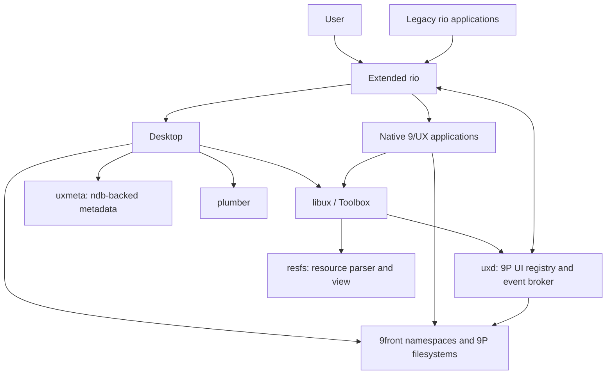

# 9/UX — A Macintosh-inspired graphical environment for 9front

**Design draft:** v0.1 · 10 November 2026  
**Status:** Proposed; no implementation implied

## 1. Summary

9/UX is a new native graphical platform for 9front. Its interaction model is inspired by the classic Macintosh and A/UX: a spatial desktop, global menu bar, consistent controls and dialogs, iconic applications, and resource-driven presentation. Its implementation is Plan 9-native: rio and libdraw provide display and windows; 9P exposes GUI state and control; namespaces represent the working environment; the plumber handles document dispatch; ndb provides human-editable metadata and associations.

**9/UX is not an emulator, a Macintosh ABI, or an A/UX reimplementation.** Native 9front applications remain first-class citizens, and existing rio applications must continue working.

### Goals

1. Recreate the *experience* of a classic Macintosh desktop, not binary compatibility.
2. Extend rio instead of replacing it.
3. Expose applications' widget trees, state, commands, and events over 9P by design.
4. Make Desktop a graphical view and editor of a chosen Plan 9 namespace.
5. Preserve classic Mac resource formats where useful, especially icons and declarative UI resources.
6. Make the system inspectable and scriptable using ordinary Plan 9 tools.
7. Work with local and remote 9P filesystems without hiding their semantics.

### Non-goals

- Running 68k Mac applications or cloning the Macintosh Toolbox ABI.
- Introducing a new graphics kernel, compositor, or binary package format in v1.
- Guaranteeing that all mounted filesystems support Desktop operations such as move, trash, custom metadata, or change notifications.
- Turning every legacy 9front application into an accessible 9/UX application automatically.

## 2. Architecture



**Ownership:** rio manages display-wide interactions; Desktop manages the desktop metaphor and filesystem operations; libux implements per-application controls; each application remains authoritative for its own widget state; `uxd` publishes and routes 9P-visible UI; `uxmeta` owns metadata mutations; `resfs` interprets resources. Components communicate through deliberately small file protocols rather than a monolithic desktop daemon.

## 3. Extended rio

### Responsibilities

- Preserve existing `/dev/wctl`, `/dev/mouse`, `/dev/kbd`, `/dev/snarf`, `/mnt/wsys`, window creation, drawing, and nested rio behavior.
- Provide a reserved **desktop layer** behind normal windows. Desktop draws on this layer and receives pointer events only when the desktop is hit.
- Provide a global **menu bar** that tracks the foreground 9/UX application and dispatches commands without transferring focus to a menu-window workaround.
- Track window-to-application ownership and focus transitions.
- Offer opt-in Macintosh-style window chrome, leaving legacy rio windows fully usable.
- Broker cross-window drag initiation, target discovery, and drop acceptance.
- Expose global interaction events and control files via an additive 9P interface.

### Proposed rio extension namespace

The following is **new**, not a description of stock rio. In a client's rio-mounted namespace, a possible tree is:

```text
/dev/ux/
    version                 # read: protocol version / capabilities
    events                  # per-open stream: focus, windows, desktop changes
    desktop/
        ctl                 # claim/release desktop ownership
        events              # background pointer / resize events
    menubar/
        ctl                 # per-app menu registration and updates
        events              # selected menu commands
    drag/
        ctl                 # begin/accept/cancel drag
        events              # enter/leave/drop/cancel
```

Window-specific registration can use the existing immutable `/dev/winid` as its key, rather than inventing a separate window identity. `uxd` maps one or more rio window IDs to a logical application ID.

**Legacy behavior:** If an application has not registered a menu, rio shows its traditional operations or a minimal legacy menu. Compatibility is opt-in per window; the classic rio interactions remain available. A mode switch can disable 9/UX presentation altogether.

### Input and desktop behavior

Rio owns hit-testing and routes events in order: global menu bar → active drag → window chrome → topmost window → the desktop (Desktop). Menus are per *application*, with window-specific overrides if needed. Keyboard shortcut handling must define explicit precedence and never silently intercept established shortcuts of legacy applications.

## 4. Desktop

Desktop is a native 9front application composed of the desktop client, folder windows, file operations, metadata integration, and launch logic.

### User experience

- Disk/volume icons; desktop aliases and pinned paths; Trash; spatial icon placement.
- Folder windows with icon, list, and optional hierarchical views.
- Double-click to open, drag to move/copy, selection, rename, duplicate, Get Info.
- Remember folder geometry, view mode, sorting, icon layout, and desktop arrangement.
- Standard menus and keyboard shortcuts supplied through libux and rio.
- Local or remote file servers visually presented as volumes **when explicitly registered**.

### Plan 9 filesystem model

A folder is a directory and a document is a file. A volume is **not inferred from every path**: it is a named mount or namespace root declared in a workspace/session volume registry. Desktop operates in a session namespace assembled at login. Child applications inherit or explicitly mount that namespace, with normal Plan 9 behavior preserved.

Different processes may hold different namespaces; Desktop must **not** pretend that a path in its namespace necessarily refers to the same object in another process. Launch records carry a workspace/namespace context; a path-like drop outside that context needs a mediated file-transfer service instead of blind path reuse.

File operations are capability-driven. Where a server lacks rename or other required operations, Desktop reports the limitation or offers explicit copy-and-delete semantics. A Trash folder is best-effort and filesystem-specific, not a universal atomic operation.

### Launching and associations

Desktop resolves document types using the 9/UX metadata registry but delegates ordinary opening to the existing **plumber**. Configuration should generate or complement plumbing rules rather than create an incompatible second launcher. Explicit user association overrides may be applied through the 9/UX launcher before a plumb message is sent.

### Persistence

Desktop state is keyed primarily by workspace, directory path, and entry name; optional filesystem/Qid information helps detect changes but is **not assumed durable across remounts or server restarts**. Renames performed through Desktop update its metadata; out-of-band moves may require reconciliation. Desktop can periodically rescan directories; native change notifications are an optional optimization.

## 5. Toolbox (`libux`): native, 9P-visible UI

`libux` is a native C library built around `libdraw`, `libthread`, and selectively reusable `libcontrol` ideas. It provides controls, layout, dialogs, menus, text input, file choosers, application lifecycle, resource lookup, clipboard integration, and accessibility/automation metadata.

### Fundamental decision

**Controls are actual application state, not just pixels.** Every 9/UX application publishes a typed control tree through a 9P server. Local UI code and remote/scripted clients observe the same state. `libux` may use in-process channels for speed, but its public object model is also exposed as 9P.

Example published tree, aggregated by `uxd`:

```text
/mnt/ux/
    apps/
        sketch-42/
            name
            ctl                    # application commands
            events                 # subscription stream
            windows/
                17/
                    title
                    ctl
                    controls/
                        save/
                            type   # button
                            label  # Save
                            state  # enabled, visible, focused, ...
                            ctl    # e.g. 'activate'
                            events # activation / state transitions
                        name/
                            type   # text-field
                            value
                            ctl
                            events
```

The tree is illustrative, not a finalized wire specification. Paths use stable application-scoped control IDs (not labels or screen coordinates). Dynamic controls can appear and disappear. Window IDs correlate to rio's existing `winid`.

### Protocol conventions

- **Read state, write commands:** UTF-8 text files for small properties; newline-delimited commands for `ctl`; separate streams for events. Binary assets are separate files.
- **Events:** Opening an `events` file creates an independent subscription cursor; reads may block until events arrive. Messages include a monotonic sequence number and control identity. Queue overflow produces an explicit `lost`/`resync` indication, not silent corruption.
- **State:** Readable snapshots are authoritative; events describe subsequent changes. Reattach or `lost` requires a new snapshot.
- **Ordering:** An individual application serializes mutations to its own UI thread. 9P reads and writes must not block that thread waiting on a remote client.
- **Permissions:** Introspection is distinct from mutation. Reads may redact secrets; writes to control files require an explicit policy grant. Display focus alone is not an authorization token.
- **Versioning:** A small protocol version and advertised feature list allow forward evolution.

### User interface objects

Initial primitives: `App`, `Window`, `Menu`, `Dialog`, `Button`, `TextField`, `Checkbox`, `List`, `ScrollView`, `IconView`, and `FileChooser`. Rectangular regions are local to the owning window. `libux` draws widgets into normal `libdraw` windows; rio never renders application controls.

### Menus, clipboard, and drag-and-drop

Menus are registered through libux/`uxd`, but **rio renders and dispatches the global bar**. Application menus are declarative and expose stable action IDs, enabling both clicks and 9P writes.

Text clipboard operations interoperate with existing rio `snarf`. Additional typed representations (file references, images, rich text) live behind an optional 9P clipboard service. Drag payloads are typed offers; the target accepts an offer, and any bytes or files are retrieved through an explicitly mounted or brokered endpoint. Do not assume pathnames are meaningful in the target namespace.

## 6. Metadata: ndb + `uxmeta`

Use ndb's human-readable tuple format for defaults, associations, application declarations, volume registry, icon selection, and Desktop layout. **Do not use ndb itself as a concurrent transactional database**: `uxmeta` owns updates, serializes writes, performs atomic file replacement where supported, and publishes a generation number or change stream.

Possible configuration:

```text
app=sketch exec=/apps/Sketch/sketch icon=sketch
    resources=/apps/Sketch/resources.rsrc

ext=.txt open=edit icon=text
ext=.png open=page icon=image

volume=home path=/usr/glenda icon=disk desktop=yes

folder=/usr/glenda/doc view=icons sort=name
    x=100 y=90 width=550 height=400
```

Layer precedence: system defaults → installed-application metadata → user preferences → workspace overrides. Unknown keys are preserved where possible. Untrusted external filesystems cannot edit the system registry merely by presenting an ndb file. Metadata derived from file contents is lower-trust than user/system configuration.

File association entries inform Desktop and the generated plumbing configuration; the plumber remains the main dispatch path.

## 7. Resources and application packaging

Classic Macintosh resource forks are a useful **asset and declarative UI format**, not an executable compatibility layer. 9/UX should initially read legacy resource data and preserve opaque unknown resource types. Support imports from bare `.rsrc` files and, later, AppleSingle/AppleDouble wrappers.

Priority resource types:

| Type | Use |
|---|---|
| `ICN#`, `ics#`, `icl4`, `icl8`, `ics4`, `ics8` | Icons and masks |
| `CURS` | Cursors |
| `STR `, `STR#` | Strings |
| `MENU` | Menu declarations |
| `DLOG`, `DITL`, `ALRT` | Declarative dialogs/alerts |
| `PICT` | Optional later image decoding |
| `BNDL`, `FREF` | Import hints for associations, not authoritative registry |

`resfs` can decode and expose assets through 9P:

```text
/mnt/res/sketch/
    icon/128/image        # decoded image in documented format
    MENU/128/raw
    MENU/128/text
    STR#/128/raw
```

Each resource is identified by `(type, signed 16-bit ID[, name])`; names require MacRoman-to-UTF-8 conversion where applicable. Decoding must validate lengths, offsets, bounds, masks, and dimensions before allocation. The v1 tooling may provide a text resource format compiled into a resource file, so applications need not use classic Apple development tools.

Suggested native app layout:

```text
/apps/Sketch/
    sketch
    app.ndb
    resources.rsrc
```

Distribute original 9/UX graphics and fonts. Do not bundle copyrighted Macintosh system resource assets without permission; let users import their own resource files.

## 8. Services and interfaces

| Component | Owns | Public interface |
|---|---|---|
| Extended `rio` | Windows, menu surface, desktop layer, input routing | Existing rio 9P + `/dev/ux` |
| `desktop` | Spatial desktop, folders, file operations, launch UI | Standard libux widgets + its own UI tree |
| `libux` | Widgets, dialog/layout engine, event model | C API; per-app 9P server |
| `uxd` | Application registration, UI-tree aggregation, policy, event routing | `/mnt/ux/apps/...` 9P |
| `uxmeta` | Registry and persistent preferences | 9P queries/updates; ndb files on disk |
| `resfs` | Resource decoding and typed resources | Read-only 9P file tree |
| `plumber` | Document dispatch | Existing plumbing messages |

The name `uxd` is a convenience, **not a mandate for one giant daemon**: rio's extensions and the application-owned servers stay independent. Mounted services can be restarted independently when their state permits.

## 9. Security and reliability

- **Per-user sessions:** Publish UI services locally to the session by default. Remote mounting or exporting is explicit and authenticated; session identity is not inferred solely from a process ID or path.
- **Default-deny control:** Introspection, activation, changing text, clipboard access, injecting keyboard events, and reading sensitive widgets have separate grants.
- **Secrets:** Password controls expose type/visibility but never plaintext values or input events to external readers.
- **Filesystem boundaries:** Desktop respects directory permissions and server operation support. No automatic access to another application's namespace.
- **Resource files:** Treat as untrusted; cap sizes and counts, verify offsets, and fuzz decoders.
- **Failure isolation:** Desktop, resource and metadata services can die without tearing down rio. Applications fall back to their own UI where possible; legacy apps keep working.
- **Stalled clients:** No application can indefinitely block rio's input loop or the libux event loop via a 9P read/write.

## 10. Incremental implementation

**Phase 0 — Baseline and compatibility**
- Build and run a 9front rio fork; establish regression tests for ordinary rio windows, `acme`, `sam`, nested rio, and CPU-server clients.
- Document stock rio's 9P contracts and proposed additive files.

**Phase 1 — Desktop and menu bar**
- Add reserved desktop draw/input surface and menu strip to rio.
- Implement focus notifications and per-window/app menu registration.
- Run a tiny desktop client and a sample 9/UX app while legacy windows remain usable.

**Phase 2 — 9P Toolbox**
- Implement a minimal libux with Button, TextField, Window, Menu, Dialog.
- Publish controls via per-app 9P servers; add `uxd` registry, per-open event subscriptions, and permission checks.
- Demonstrate shell-based read/update/activation of a running UI.

**Phase 3 — Desktop MVP**
- Desktop volumes, folder icon view, select/open/rename, Get Info, window and icon persistence.
- Implement `uxmeta` with ndb-backed configuration and one serialized writer.
- Integrate plumbing; explicitly support local and mounted remote directories.

**Phase 4 — Resources and full interaction**
- Add `resfs` parsing and classic icon support, then menus and dialogs.
- Add drag/drop negotiation, text snarf interoperability, typed clipboard, and Trash with clear per-filesystem limitations.
- Theme and polish the Macintosh-inspired visual language.

### First end-to-end demo

Boot 9front into extended rio. The desktop shows a named local volume and a remote 9P-mounted volume. Open a folder, double-click a text file (plumbed to an editor), launch a native libux sample, use its global menu, then from an `rc` window inspect `/mnt/ux/apps/...` and activate a button by writing to its `ctl` file. Existing `acme` and ordinary rio windows continue behaving normally.

### Acceptance criteria for v0.1

1. No regressions to stock rio's documented file interfaces.
2. Desktop draws desktop icons, opens directories, and launches documents via plumbing.
3. Menu bar follows a multi-window 9/UX application with correct focus behavior.
4. At least three native controls expose read state, write commands, and independent event subscriptions over 9P.
5. ndb persistence survives session restarts and handles external edits safely.
6. Imported `ICN#` and `icl8` resources render correctly on actual 9front display formats.
7. A mounted remote 9P directory works as a Desktop volume with honest operation/error reporting.
8. Unprivileged 9P clients cannot mutate another app's controls without authorization.

## 11. Open design questions

- Should 9/UX be a compile-time rio fork, a runtime mode of rio, or a thin downstream patch set? **Provisional:** runtime mode with additive behavior.
- Should the UI tree be hosted by each application and aggregated by `uxd`, or proxied wholly by `uxd`? **Provisional:** app-owned truth, brokered discovery and policy.
- How should workspace/mount identity be represented across process namespaces and restarts? **Provisional:** explicit registry and launched workspace context; avoid pretending a global namespace exists.
- Do we need native resource-source syntax from day one? **Provisional:** parse/import classic `.rsrc` first, add authoring tools later.
- What are the default keyboard mappings on terminals without a Mac Command key? **Provisional:** configurable and preserve existing rio conventions.

## 12. Technical references

- [9front rio(4) manual](https://glenda.0x46.net/manuals/9front/4/rio/) — current exposed window files and event behavior.
- [Plan 9 rio(1)](https://9p.io/magic/man2html/1/rio) — window creation and namespace behavior.
- [Plan 9 libcontrol(2)](https://man.aiju.de/2/control) — channel-oriented control architecture.
- [Plan 9 ndb(6)](https://9p.io/magic/man2html/6/ndb) — native tuple database syntax.
- [Inside Macintosh: More Macintosh Toolbox](https://vintageapple.org/inside_r/pdf/More_Macintosh_TB_1993.pdf) — Resource Manager and classic assets.
- [9front source mirror](https://github.com/9front/9front/tree/front/sys/src/cmd/rio) — rio source to extend.

---

**Design principle:** *Keep the Macintosh's direct-manipulation desktop, but make every meaningful object, action, and resource visible as a Plan 9 file.*
