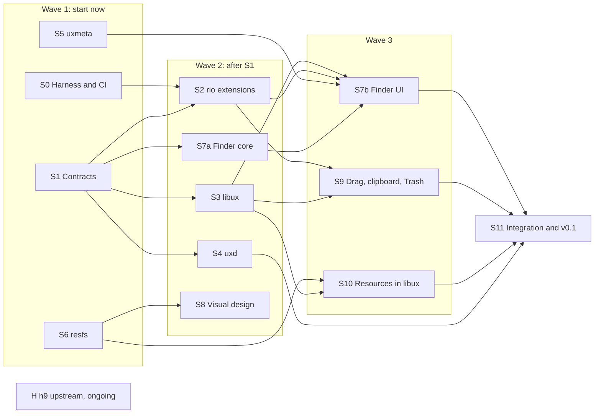

# 9/UX work plan for parallel threads

[plan.md](plan.md) says *what* each phase delivers. This document cuts the
same work into **workstreams** that separate threads (people or agents)
can run at the same time, and says what each one owns, needs, and hands
off. Each stream's section is written to be handed to a thread as its
brief.

## How parallel work stays unblocked

All streams commit straight to the shared **`dev`** branch; there are
no pull requests. `main` is updated from `dev` at milestones.

1. **Contracts first.** The files between components are written down
   in `docs/protocols/` before code relies on them. Once a protocol doc
   is on `dev`, both sides build against it, not against each other.
2. **Fakes for every contract.** Each protocol ships with a small fake
   server (or fake client) under `test/fakes/`, so a stream can test
   against `/dev/ux` or `/mnt/ux` before the real one exists.
3. **Directory ownership.** Each stream owns its directories; nobody else
   edits them. Shared files (`README.md`, `docs/plan.md`, this file,
   root `mkfile`, `scripts/pins.sh`) change only in small commits that
   touch nothing else.
4. **Small commits, rebased.** Commit often, each commit building and
   passing its tests. Before pushing, `git pull --rebase origin dev`;
   never force-push `dev`. Start each commit message with the stream's
   area (`rio:`, `libux:`, `protocols:`, ...).
5. **Protocol changes are their own commits.** A stream that needs a
   contract changed commits the doc and its fake together, says so in the
   message, and tells the affected streams' threads. No silent drift.
6. **Keep `dev` green**: run `scripts/test.sh` (once it exists) before
   pushing, including the stock-rio regression suite. If you break
   `dev`, fixing it comes before anything else.
7. **h9 is pinned** in `scripts/pins.sh`. A stream that hits an h9 gap
   records it in `docs/h9-needs.md` and works around it; the h9 stream
   (H) takes it upstream and bumps the pin.

## Waves

| Wave | Streams | Can run at once | Starts when |
|---|---|---|---|
| 1 | S0, S1, S5, S6 (plus H as needed) | 4 | Now |
| 2 | S2, S3, S4, S7a, S8 | 5 | S1's protocol docs and fakes land on `dev`; S2 also needs S0's harness |
| 3 | S7b, S9, S10 | 3 | Their inputs below are on `dev` |
| 4 | S11 | 1 | Wave 3 is done |

S5 and S6 run from wave 1 to the end, so up to seven threads can be busy
in wave 2.

## Ownership

| Stream | Owns |
|---|---|
| S0 Harness and CI | `scripts/`, `test/harness/`, `test/rio/`, `.github/`, `docs/protocols/rio.md` |
| S1 Contracts | `docs/protocols/devux.md`, `docs/protocols/ux.md`, `test/fakes/` |
| S2 rio extensions | `rio/` |
| S3 libux | `libux/`, `apps/sample/` |
| S4 uxd | `uxd/` |
| S5 uxmeta | `uxmeta/`, `docs/protocols/meta.md` |
| S6 resfs | `resfs/`, `docs/protocols/res.md` |
| S7 Finder | `finder/` |
| S8 Visual design | `assets/` |
| S9 Drag, clipboard, Trash | `clipd/`, plus drag code in `rio/` and `libux/` with S2 and S3 reviewing |
| S10 Resources in libux | `libux/res*.c`, with S3 reviewing |
| S11 Integration | `test/e2e/`, `docs/release.md` |
| H h9 upstream | `docs/h9-needs.md` here; changes land in progrium/hyper9 |

---

## Wave 1

### S0: Harness and CI

**Goal:** anyone can build 9/UX and run its tests with one command,
locally and in CI, and stock rio's behavior is pinned down by tests.

**Depends on:** nothing.

**Work:**
1. Make `scripts/h9.sh` (pinned h9) work on macOS arm64 and Linux amd64.
   Confirm `scripts/h9.sh --rc 'mk'` builds `rio/`, and the `--gfx` run.
2. `test/harness/`: a Zig program that depends on h9 at `H9_REV` as a
   package, starts machines on the headless screen, and gives tests
   helpers: type, click, drag, wait for a window, read and write files
   in the machine, and compare a screen region with a golden PNG.
3. `scripts/test.sh` runs the unit, interface (rc), and GUI tests.
4. CI on GitHub Actions (Linux x86_64). Work out which h9 backend runs
   there (native, or the emulator) and how to get the amd64 root (unpack
   the release ISO, cached).
5. The stock rio regression suite in `test/rio/` (list in plan.md, Phase
   0), and `docs/protocols/rio.md` describing the files it pins down.
6. Check the h9 assumptions at the end of development.md; record the
   gaps in `docs/h9-needs.md`.
7. A written recipe for the QEMU 9front VM checks (rcpu, drawterm to a
   CPU server), run once by hand.

**Done when:** CI is green on `main` with the regression suite, and a new
checkout runs `scripts/test.sh` with nothing else set up.

**First commit:** `scripts/h9.sh` verified, plus a harness test that boots
`rio/` headless and sees a window open.

### S1: Contracts

**Goal:** the shared protocols are written, reviewed, and fakeable, so
wave 2 can build both sides at once.

**Depends on:** nothing. Read the design §3, §5, §8, §9 closely.

**Work:**
1. `docs/protocols/devux.md`: rio's `/dev/ux` tree. Version and
   capabilities, the events stream format, desktop `ctl`/`events`, the
   menu bar registration format (menus keyed by app and `winid`, stable
   action IDs, enable/check state, shortcuts), and drag `ctl`/`events`.
   Decide the hit-test and keyboard-shortcut precedence.
2. `docs/protocols/ux.md`: the per-app control tree served by libux and
   aggregated by uxd. File names per control type, `ctl` command
   grammar, the event message format (sequence numbers, `lost`/`resync`),
   snapshot rules, how apps register with uxd, the permission and grant
   model, secret redaction, and versioning.
3. Shared conventions in `docs/protocols/README.md`: text encoding,
   quoting (use `tokenize`/`quote` rules), error strings, IDs.
4. Fakes in `test/fakes/`: `fakedevux` (serves `/dev/ux` with scripted
   focus and menu events, records registrations) and `fakeapp` (serves a
   fixed control tree with a button and a text field). Both small C
   programs on lib9p, plus rc tests that exercise them.
5. Settle design open questions 1, 2 and 5 in the docs.

**Done when:** both protocol docs and the fakes are on `dev`, and S2, S3
and S4 have each reviewed the doc they implement.

**First commit:** `devux.md` and `ux.md` drafts for review (no code), then the
fakes in a second commit.

### S5: uxmeta

**Goal:** the metadata service: ndb files in, consistent answers and safe
writes out.

**Depends on:** nothing to start; uses `ux.md` conventions once they land.

**Work:**
1. `docs/protocols/meta.md`: the ndb schema (apps, extensions/types,
   volumes, folders and layout, icons), the precedence layers, and the
   9P interface (query, update, generation number or change stream).
2. A library for reading the layered ndb files with precedence, keeping
   unknown keys.
3. The `uxmeta` 9P server: one serialized writer, atomic replace, a
   generation number, picking up external edits, refusing registry
   changes from untrusted sources.
4. Generating plumbing rules from associations, kept in a separate file
   the user's own rules include.
5. Tests: precedence, concurrent writers, an external edit mid-session,
   restart persistence (acceptance criterion 5).

**Done when:** Finder's needs in plan.md Phase 3 can be met through the
9P interface alone, with tests.

**First commit:** `meta.md` plus the layered reader with tests.

### S6: resfs

**Goal:** a safe parser and file server for classic resource files.

**Depends on:** nothing.

**Work:**
1. `docs/protocols/res.md`: the `/mnt/res` tree and the decoded formats
   (9front `image(6)` for icons with masks, UTF-8 text for `STR#` and
   `MENU`, a text form for `DLOG`/`DITL`/`ALRT`).
2. A resource-map parser in portable C that checks every length, offset,
   count, and dimension before allocating. Build it for the host too and
   fuzz it (libFuzzer) in CI, with a seed corpus of hand-made files (no
   Apple assets in the repo).
3. Decoders: `ICN#`, `ics#`, `icl4`, `icl8`, `ics4`, `ics8` (with the
   classic 4- and 8-bit palettes), `CURS`, `STR `, `STR#`, `MENU`,
   `DLOG`, `DITL`, `ALRT`; MacRoman to UTF-8 for names and strings.
4. The read-only 9P server.
5. Later: AppleSingle/AppleDouble, and a text resource format compiled
   into `.rsrc` (needed by S8 and S10).

**Done when:** `resfs` serves icons that render correctly, compared with
golden images, and the fuzzer has run clean for a sustained run in CI.

**First commit:** the parser and fuzz target, without the 9P server.

---

## Wave 2

### S2: rio extensions

**Goal:** rio gets `/dev/ux`, the desktop layer, and the menu bar, and
stock behavior doesn't change.

**Depends on:** S1's `devux.md`; S0's harness and regression suite.

**Work:** plan.md Phase 1, items 1 to 4: `/dev/ux/version` and `events`,
the desktop layer, the menu bar with per-app registration and a legacy
fallback, hit-test order, and a mode switch that turns 9/UX off. Keep
9/UX code in new `ux*.c` files with small hooks in upstream ones. Drag
`ctl`/`events` come later with S9.

**Done when:** the regression suite still passes, and tests using
`fakeapp`-style clients show the menu following focus, menu commands
arriving by click and by file write, and desktop clicks reaching a
desktop client (acceptance criterion 3).

**First commit:** `/dev/ux/version` and `/dev/ux/events` with focus events.

### S3: libux

**Goal:** the Toolbox: controls that are real 9P objects.

**Depends on:** S1's `ux.md` and `devux.md`. Tests use `fakedevux` until
S2 lands.

**Work:** plan.md Phase 2, items 2, 3 and 5: the libthread app model
(UI proc, 9P proc that never blocks it, bounded per-open event queues),
then `Window`, `Button`, `TextField`, `Menu` (registered with the menu
bar through `/dev/ux`), `Dialog`, and a sample app in `apps/sample/`.
After that: `Checkbox`, `List`, `ScrollView`, `IconView`, `FileChooser`,
which Finder needs.

**Done when:** from rc, a test reads a text field's value, activates a
button through `ctl`, and two independent `events` readers see it; a
stalled reader doesn't stall the UI (acceptance criterion 4).

**First commit:** the app model and `Button` in a plain rio window, with its
tree served.

### S4: uxd

**Goal:** discovery and policy across apps at `/mnt/ux/apps`.

**Depends on:** S1's `ux.md`. Tests use `fakeapp` until S3 lands.

**Work:** plan.md Phase 2, item 4: app registration, `winid`-to-app
mapping, the aggregated tree (passing through to app servers, not
copying state), grants (read by default, writes need a grant, secrets
redacted), and surviving restarts of itself and of apps.

**Done when:** an unauthorized client can't change another app's
controls, an authorized one can, and restarting `uxd` loses no app state
(acceptance criterion 8).

**First commit:** registration and the aggregated read-only tree.

### S7a: Finder core

**Goal:** everything in Finder that isn't drawing, as a tested library.

**Depends on:** S1 (conventions). Uses S5's `meta.md` once it lands.

**Work:** the volume registry and workspace context; directory listing
and change detection by rescan; probing what a file server supports and
reporting it honestly; file operations (rename, duplicate, copy and
delete where rename isn't supported); Get Info data; launching through
the plumber. Tested headless, including a remote volume from a second h9
with `--serve`, and what happens when it disappears.

**Done when:** a test-driven rc or C client can do every Phase 3 Finder
operation on a local and a remote volume through the library
(acceptance criterion 7, without the UI).

**First commit:** volume registry and directory model with tests.

### S8: Visual design

**Goal:** 9/UX's own look: original icons, cursors, window chrome,
patterns, and font choices. No Apple assets.

**Depends on:** S6's resource format for packaging (images can start
now).

**Work:** a style guide in `assets/README.md` (palette, metrics, chrome,
menu bar, controls); original icon set (volumes, folders, documents,
apps, Trash) at classic sizes and depths; cursors; desktop patterns; a
font plan using fonts 9front can ship. Package as `.rsrc` once S6's
compiler exists. Mockups first so S2, S3 and S7b draw toward the same
target.

**Done when:** Finder and libux use only these assets, and the style
guide matches what they draw.

**First commit:** style guide and mockups.

---

## Wave 3

### S7b: Finder UI

**Depends on:** S2 (desktop layer, menu bar), S3 (controls including
`IconView`), S5 (`uxmeta`), S7a.

**Work:** the Finder app on libux: desktop icons, folder windows (icon
and list views), selection, open, rename in place, Get Info windows,
menus, and layout saved in `uxmeta`.

**Done when:** the first half of the end-to-end demo works, and layout
survives restarts and external edits (acceptance criteria 2, 5, 7).

### S9: Drag, clipboard, Trash

**Depends on:** S2, S3; S7b for Finder drags.

**Work:** `/dev/ux/drag` in rio, drag sources and targets in libux,
typed offers with brokered payloads (never bare paths across
namespaces), snarf interop, the optional typed clipboard service, and
Trash per file system with its limits shown.

**Done when:** a file dragged from Finder onto an app and between Finder
windows works, and cross-namespace drops go through the broker.

### S10: Resources in libux

**Depends on:** S3, S6.

**Work:** libux loads icons, `MENU`, `STR#`, and `DLOG`/`DITL`/`ALRT`
from an app's resources through resfs, and builds menus and dialogs from
them.

**Done when:** the sample app's menus and a dialog come from its
`.rsrc`, and imported `ICN#`/`icl8` icons render correctly (acceptance
criterion 6, together with S11's check on a real display).

---

## Wave 4

### S11: Integration and v0.1

**Depends on:** everything above.

**Work:** the end-to-end demo as one headless test in `test/e2e/`, a run
by hand under `h9 --gfx` and on a 9front VM, each acceptance criterion
checked and recorded in `docs/release.md`, then the v0.1 tag.

---

## H: h9 upstream (ongoing)

**Goal:** the things 9/UX needs from h9 get built there, and the pin
moves forward safely.

**Work:** triage `docs/h9-needs.md`; write h9 design proposals and changes in
progrium/hyper9 for real gaps (likely candidates: a headless screen from
the CLI with a screenshot file, so tests can be plain rc; any devdraw or
input gaps the regression suite finds); bump `H9_REV` in its own commit once
CI passes.

**Runs:** only when there's something on the list. This stream works in a
different repository.

## Starting threads

Start wave 1 as four threads, one per stream (S0, S1, S5, S6), each
given its section of this file as the brief plus links to the design and
plan. Start each wave 2 stream when its inputs are on `dev`; S1's protocol
docs are the main gate.
